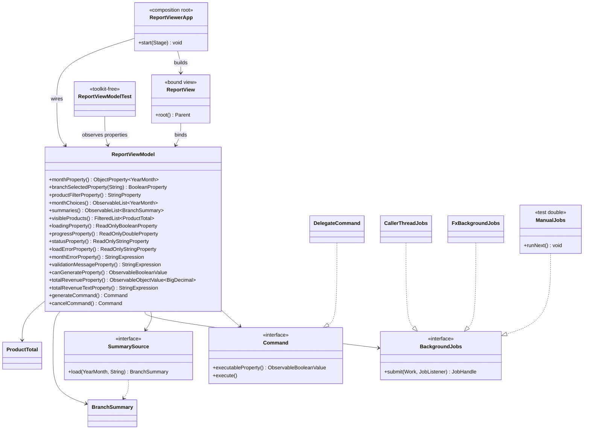

# Lab-03 · ReportViewModel design

Team: Aurora · Member: sokuntheary-chheng (Chheng Sokuntheary)

The design of `edu.itc.salesreport.ui.ReportViewModel`: what moves out of
the Lab-02 controller and presenter, which members the ViewModel exposes,
and how the pieces relate. Code names below are the ones of tag
`lab-02-final`; Task 2 moves the Lab-02 MVC screen classes to `ui.mvc`
(`ReportController`) and `ui.mvc.fx` (the JavaFX MVC view, apps and
`FatReportController`), so the rows keep pointing at the same code.

## 1. Controller inventory (Lab-02 → new owner)

One row per control the Lab-02 screen reads or writes, and per `if` /
`switch` / `catch` its logic contains (16 rows, ≥ 8 required).

| # | code (lab-02-final) | concern | new owner |
|---|---|---|---|
| 1 | `ui.fx.ReportView.monthField`, `bind()` → `controller.monthEntered(text)` | raw month text read on Enter | View: the control. State: ViewModel input `month` (two-way). Rule: ViewModel `monthError` |
| 2 | `ui.fx.ReportView.branchBox`, `bind()` → `controller.branchChosen(value)` | branch picked from a combo | ViewModel input `branchSelected(b)` + output `monthChoices` (combo becomes tick boxes) |
| 3 | `ReportController.monthEntered` — `switch (InputRules.month(text, clock))` (Valid / Invalid) | month rule: required, not in the future | ViewModel computed `monthError`, driven by the injected `Clock` |
| 4 | `ReportController.branchChosen` — `switch (InputRules.branch(text))` (Valid / Invalid) | branch rule: known code | superseded: the tick boxes only offer valid codes; "at least one ticked" becomes ViewModel `branchError` |
| 5 | `ReportController.execute` — `catch (NoSuchFileException)` / `catch (IOException)` | load failure message | ViewModel job listener `failed()` → outputs `loadError` + `status` |
| 6 | `ReportController.execute` — `model.load(dataDir, month)` | the controller reads files | ViewModel `generate` command → `SummarySource` port → Model (`ingest` + `engine`) |
| 7 | `ReportController.execute` — `model.selectBranch(branch)` | switch the visible rows | superseded: every ticked branch is loaded into output `summaries` |
| 8 | `ui.fx.ReportView.modelChanged` — `table.getItems().setAll(...)` | table rows pushed by an event | ViewModel output `summaries`, one-way bound |
| 9 | `ui.fx.ReportView.modelChanged` — `chart.getData().setAll(series())`, `series()` reads `revenueByCategory` | revenue-by-category chart | ViewModel output `summaries` (the category map travels inside `BranchSummary`); the Lab-03 screen drops the chart |
| 10 | `ui.fx.ReportView.modelChanged` — `status.setText(statusText(event))` | status line | ViewModel output `status` |
| 11 | `ui.fx.ReportView.showError` / `clearError` — `error.setText(...)` | error line | ViewModel outputs `loadError` (load) and `validationMessage` (input) |
| 12 | `FatReportController.onLoad` / `onBranchChosen` | event forwarding to the controller | ViewModel commands `generate` / `cancel` (`DelegateCommand`) |
| 13 | `ReportPresenter.money` — `String.format(Locale.US, "%,.2f", …)` | money formatting in the presenter | ViewModel computed `totalRevenue` + `totalRevenueText` (`USD 12,345.60`) |
| 14 | `ReportPresenter.modelChanged` — `screen.showRows(...)` / `showCategoryRevenue(...)` | formatted values pushed to the screen | ViewModel outputs `summaries` + `visibleProducts` (product filter) |
| 15 | `InputRules.month` — `if (blank)`, `if (parse fails)`, `if (after now)` | the three month checks | ViewModel `checkMonth` (the copy in `InputRules` stays for the Lab-02 entry points) |
| 16 | no Generate/Cancel exists; `model.load` runs on the FX thread | the screen freezes during a load | ViewModel `loading`, `progress`, `cancelCommand` + the `BackgroundJobs` port |

## 2. ViewModel members

### Input — the view may write these (two-way bound)

| member | type | view may write |
|---|---|---|
| `month` | `ObjectProperty<YearMonth>` | yes |
| `branchSelected(b)` for PNH, REP, BTB | `BooleanProperty` each | yes |
| `productFilter` | `StringProperty` | yes |

### Output — read-only types, the view only binds one-way

| member | exposed type | view may write |
|---|---|---|
| `monthChoices` | `ObservableList<YearMonth>` (unmodifiable) | no |
| `summaries` | `ObservableList<BranchSummary>` (unmodifiable) | no |
| `visibleProducts` | `FilteredList<ProductTotal>` (filtered view) | no |
| `loading` | `ReadOnlyBooleanProperty` | no |
| `progress` | `ReadOnlyDoubleProperty` | no |
| `status` | `ReadOnlyStringProperty` | no |
| `loadError` | `ReadOnlyStringProperty` | no |

### Computed — bindings, never set by anyone

| member | type | rule |
|---|---|---|
| `monthError` | `StringExpression` | `Choose a month.` / `Month 2026-10 is in the future.` / empty (Task 3) |
| `branchError` | `StringExpression` | `Select at least one branch.` / empty (Task 3) |
| `validationMessage` | `StringExpression` | the non-empty messages joined by a space (Task 3) |
| `valid` | `ObservableBooleanValue` | `monthError` and `branchError` both empty (Task 3) |
| `canGenerate` | `ObservableBooleanValue` | `valid and not loading` |
| `totalRevenue` | `ObservableObjectValue<BigDecimal>` | sum of `summaries` revenues |
| `totalRevenueText` | `StringExpression` | `USD 12,345.60`, `Locale.US`, 2 decimals |

### Commands

| member | implementation | executable when |
|---|---|---|
| `generate` | `DelegateCommand(this::generate, canGenerate)` | valid input and no load running |
| `cancel` | `DelegateCommand(this::cancel, loading)` | a load is running |

## 3. Ports and composition

| port (interface) | one implementation in production | test double |
|---|---|---|
| `SummarySource` | lambda in `ReportViewerApp` over `CsvMonthReader` + `DefaultSalesAggregator` | lambda in `ReportViewModelTest` (may throw) |
| `BackgroundJobs` | `CallerThreadJobs` (Task 2 baseline), `FxBackgroundJobs` (Task 4) | `ManualJobs` (queued, run by the test) |
| `Command` | `DelegateCommand` | — |

`ReportViewerApp` is the composition root: the only class that builds a
concrete `SummarySource`, picks the `BackgroundJobs` implementation and
hands everything to `new ReportViewModel(source, jobs, clock)`.

## 4. Class diagram



## 5. Files added by Task 1

| File | Purpose |
|---|---|
| `src/main/java/edu/itc/salesreport/ui/Command.java` | action + observable "can run now" flag (starter, verbatim) |
| `src/main/java/edu/itc/salesreport/ui/DelegateCommand.java` | `Command` guarded by a condition (starter, verbatim) |
| `src/main/java/edu/itc/salesreport/ui/SummarySource.java` | the model seen by the ViewModel (starter, verbatim) |
| `src/main/java/edu/itc/salesreport/ui/BackgroundJobs.java` | threading port with progress and cancellation (starter, verbatim) |
| `src/main/java/edu/itc/salesreport/ui/ReportViewModel.java` | Task 1 skeleton: state, commands, ports (starter, TODOs for Tasks 2–4) |

## 6. Import rule check (Task 1, run on this code)

```text
$ grep -n "^import javafx" src/main/java/edu/itc/salesreport/ui/ReportViewModel.java
12:import javafx.beans.binding.Bindings;
13:import javafx.beans.binding.BooleanBinding;
… (lines 14–31 omitted: javafx.beans.binding.*, javafx.beans.property.*,
    javafx.beans.value.*)
32:import javafx.collections.ObservableList;
33:import javafx.collections.transformation.FilteredList;
```

Only `javafx.beans` and `javafx.collections`; `ViewModelImportsTest`
(Task 5) makes the rule executable against `javafx.scene`, `javafx.stage`,
`javafx.application` and `javafx.concurrent`.

`mvn -q compile` exits 0 with the new classes (`mvn -q` prints nothing on
success; the run returned `EXIT=0`).
